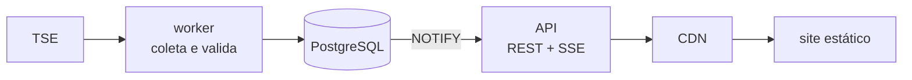

# Eleições Brasil

[](https://github.com/lucianookdp/eleicoes-brasil/actions/workflows/ci.yml)
[](LICENSE)

**[eleicoes.lucianookdp.dev](https://eleicoes.lucianookdp.dev)** · [Português](#português) · [English](#english)

## Português

Apuração das eleições brasileiras em tempo real, com os dados oficiais do TSE. Rápido no celular,
neutro e sem previsões.

**O que tem**

- Resultado ao vivo, sem recarregar a página: presidente, governadores, senadores e deputados, no
  Brasil, em cada estado, em cada município e no exterior.
- Mapa por estado, 1º e 2º turno, página de cada candidato, busca, favoritos e comparação entre
  estados.
- Modo telão para TV e painel ao vivo para o celular.
- Bancadas eleitas na Câmara e no Senado, e a composição do STF.
- Transparência da apuração: o que a coleta registrou de anormal, e de onde vem cada número.
- Página separada com o mercado de apostas Polymarket, fora da apuração.

**Princípios**

- Só dados oficiais do Tribunal Superior Eleitoral (TSE), sem alteração. Sem pesquisa nem projeção.
- "Eleito" e "2º turno" só aparecem quando o próprio TSE informa.
- Só o nosso coletor consulta o TSE, dentro dos limites que ele define; os leitores leem a nossa cópia.
- Projeto independente, sem vínculo com a Justiça Eleitoral. Sem contas, anúncios ou rastreamento.

**Como funciona**



Site em Next.js (exportação estática, GitHub Pages), API em Fastify, coleta em Node.js, PostgreSQL
com Drizzle, tudo em TypeScript, testado com Vitest e Playwright. Detalhes em
[docs/architecture.md](docs/architecture.md), [docs/tse-integration.md](docs/tse-integration.md) e
[docs/deployment.md](docs/deployment.md).

**Rodar localmente** (Node.js 22+ e pnpm)

```bash
pnpm install
docker compose up -d postgres
pnpm dev:demo   # http://localhost:3000, com uma eleição fictícia
```

**Créditos e licença**

Dados: TSE. Mapa: Victor Cazanave ([svg-maps](https://github.com/VictorCazanave/svg-maps), CC BY
4.0). Bandeiras e fotos do STF: Wikimedia Commons. Apostas: dados públicos do
[Polymarket](https://polymarket.com).

Todos os direitos reservados. O código está público apenas para consulta; copiar, reutilizar ou
publicar exige autorização por escrito. Veja [LICENSE](LICENSE).

## English

Brazilian election results in real time, from the official data of the Superior Electoral Court
(TSE). Fast on phones, neutral, and with no forecasts.

**What it has**

- Live results with no page reload: president, governors, senators and deputies, for Brazil, each
  state, each municipality and votes abroad.
- Map by state, both rounds, a page for each candidate, search, favourites and state comparison.
- TV mode for big screens and a live panel for phones.
- Seats won in the Chamber and the Senate, and the composition of the Supreme Court (STF).
- Counting transparency: what the collector recorded as abnormal, and where each number comes from.
- A separate page with the Polymarket betting market, apart from the count.

**Principles**

- Only official TSE data, unaltered. No polls and no projections.
- "Elected" and "runoff" appear only when the TSE itself says so.
- Only our collector queries the TSE, within the limits it sets; readers read our copy.
- Independent project, not affiliated with the Electoral Court. No accounts, ads or tracking.

**How it works**

A worker collects and validates the TSE's public files into PostgreSQL; the API (REST plus
Server-Sent Events) serves them through a CDN to a static site. Next.js (static export on GitHub
Pages), Fastify, Node.js, PostgreSQL with Drizzle, all in TypeScript, tested with Vitest and
Playwright. The documentation in [docs/](docs) is in Portuguese.

**Run locally** (Node.js 22+ and pnpm)

```bash
pnpm install
docker compose up -d postgres
pnpm dev:demo   # http://localhost:3000, with a fictitious election
```

**Licence**

All rights reserved. The code is public for reading only; copying, reusing or publishing it
requires prior written permission. See [LICENSE](LICENSE).

Feito por / made by [lucianookdp](https://lucianookdp.dev)
